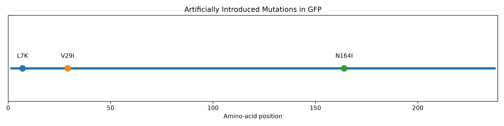

# BLAST + Pairwise Alignment Mini-Project

A reproducible protein sequence analysis workflow using Python, Biopython, and NCBI BLAST+ to identify and map artificial amino-acid substitutions in a GFP-derived query.

## Overview

This project uses Green Fluorescent Protein (GFP; UniProt accession P42212) as a reference. Three amino-acid substitutions are introduced to create a query sequence, which is analyzed using local BLASTP and global pairwise alignment.

**Key findings:** The query matched the GFP reference at 98.739% identity across 238 amino acids. Pairwise alignment recovered all three introduced substitutions. In a five-protein panel, BLASTP reported GFP as the strongest hit and red fluorescent protein as a second significant hit. In a negative control, 0 of 100 composition-preserving shuffled sequences produced a BLASTP hit at an E-value threshold of 1e-5.

## Mutation Visualization



## Objectives

- Retrieve a reference GFP sequence.
- Introduce and record artificial amino-acid substitutions.
- Build local protein databases with BLAST+.
- Compare sequences using BLASTP and pairwise alignment.
- Validate recovered substitutions against a known mutation record.
- Visualize mutation positions.

## Tools

- Python 3.11.17
- Biopython 1.88
- pandas 3.0.6
- Matplotlib 3.11.2
- NCBI BLAST+ 2.17.0+
- Conda, Ubuntu/WSL, Git

## Project Structure

```text
blast-alignment-project/
├── data/
│   ├── source_GFP.fasta
│   ├── query.fasta
│   ├── mutations.csv
│   ├── protein_panel.fasta
│   └── shuffled_query.fasta
├── results/
│   ├── blast_local.txt
│   ├── blast_panel.txt
│   ├── blast_shuffled.txt
│   ├── mismatches.csv
│   └── mutation_positions.png
├── create_mutations.py
├── download_gfp.py
├── download_protein_panel.py
├── inspect_blast.py
├── pairwise_alignment.py
├── plot_mutations.py
├── run_blast.py
├── negative_control.py
├── environment.yml
├── .gitignore
├── LICENSE
└── README.md
```

## Setup

Create the Conda environment:

```bash
conda env create -f environment.yml
conda activate blast-align
```

If the environment already exists, activate it with:

```bash
conda activate blast-align
```

Check that BLAST+ is available:

```bash
blastp -version
makeblastdb -version
```

## How to Run

Run the commands from the project root directory.

### 1. Download the GFP reference

```bash
python download_gfp.py
```

This retrieves the reference sequence and saves it to `data/source_GFP.fasta`. Internet access is required, and the download script needs a valid email configured for Biopython Entrez.

### 2. Generate artificial mutations

```bash
python create_mutations.py
```

The script uses Python's pseudorandom number generator with seed 42 to select three distinct positions and substitute each selected amino acid with a different amino acid. The substitutions are recorded in `data/mutations.csv`, and the query is saved to `data/query.fasta`.

### 3. Download the comparison protein panel

```bash
python download_protein_panel.py
```

This retrieves five protein sequences from UniProt and saves them to `data/protein_panel.fasta`.

### 4. Run local BLASTP

```bash
python run_blast.py
```

The script builds a local database from the five-protein panel using `makeblastdb`, then searches it with `blastp`. Results are saved to `results/blast_panel.txt`.

The raw BLAST output uses `-outfmt 6`, which produces tab-separated fields without a header row. The columns, in order, are:

`qseqid`, `sseqid`, `pident`, `length`, `mismatch`, `gapopen`, `qstart`, `qend`, `sstart`, `send`, `evalue`, `bitscore`.

To inspect the output with column names:

```bash
python inspect_blast.py
```

### 5. Align the reference and query

```bash
python pairwise_alignment.py
```

The script performs global pairwise alignment using BLOSUM62, a gap-opening score of -10, and a gap-extension score of -0.5. It identifies substitutions, saves them to `results/mismatches.csv`, and compares them with the known mutation record.

### 6. Plot mutation positions

```bash
python plot_mutations.py
```

The figure is saved to `results/mutation_positions.png`.

### 7. Optional: reproduce the original GFP-only BLAST search

```bash
makeblastdb \
  -in data/source_GFP.fasta \
  -dbtype prot \
  -out data/gfp_db \
  -parse_seqids

blastp \
  -query data/query.fasta \
  -db data/gfp_db \
  -out results/blast_local.txt \
  -outfmt 6 \
  -evalue 1e-5
```

### 8. Run the shuffled-sequence negative control

```bash
python negative_control.py
```

## Introduced Substitutions

| Position | Reference | Query | Mutation | BLOSUM62 score |
|---:|:---:|:---:|:---:|---:|
| 7 | L | K | L7K | -2 |
| 29 | V | I | V29I | 3 |
| 164 | N | I | N164I | -3 |

BLOSUM62 scores describe substitution scores in an alignment matrix; they are not direct measures of changes in protein stability or function.

## Results

### GFP-only BLASTP search

| Measure | Result |
|---|---|
| Reference and query length | 238 amino acids each |
| Percentage identity | 98.739% |
| Alignment length | 238 |
| Mismatches | 3 |
| Gap openings | 0 |
| Bit score | 488 |
| E-value display | 0.0 |

BLAST displays the E-value as `0.0`; this is a numerical display limit and does not mean the true value is mathematically zero.

### Five-Protein BLASTP Panel

The local protein database contains five protein sequences retrieved from UniProt on 15 October 2026.

#### Protein Panel

| No. | Protein | UniProt Accession | Organism | Sequence Length |
|---:|---|---|---|---:|
| 1 | Green fluorescent protein (GFP) | P42212 | *Aequorea victoria* | 238 aa |
| 2 | Red fluorescent protein | Q9U6Y8 | *Discosoma* sp. | 225 aa |
| 3 | Lysozyme C | P61626 | *Homo sapiens* | 148 aa |
| 4 | Insulin | P01308 | *Homo sapiens* | 110 aa |
| 5 | Myoglobin | P02144 | *Homo sapiens* | 154 aa |

#### BLASTP Results

The GFP-derived query was searched against this local database using BLASTP with an E-value threshold of `1e-5`. Two significant hits were reported.

| Subject Protein | Accession | Identity | Alignment Length | Mismatches | Gap Openings | E-value | Bit Score |
|---|---|---:|---:|---:|---:|---:|---:|
| Green fluorescent protein | P42212 | 98.739% | 238 | 3 | 0 | 0.0* | 488 |
| Red fluorescent protein | Q9U6Y8 | 25.688% | 218 | 149 | 6 | 2.39e-13 | 55.1 |

The remaining three proteins did not produce reported hits at this threshold.

*Note:* The E-value `0.0` is BLAST's displayed value for an extremely small E-value; it does not mean the true value is mathematically zero.

This is a small demonstration database, not a comprehensive protein database. Because the query was derived from GFP, the GFP match is expected rather than an independent identification of an unknown protein.

### Mutation validation

The alignment script recovered all three known substitutions:

`All mutations recovered: True`

## Shuffled-Sequence Negative Control

A negative control was performed by shuffling the amino-acid order of the GFP-derived query 100 times while preserving its length and amino-acid composition. Seeds 0 through 99 were used for reproducibility. Each shuffled sequence was searched against the same five-protein local database using BLASTP with an E-value threshold of 1e-5.

| Measure | Result |
|---|---|
| Number of shuffled sequences | 100 |
| Length of each sequence | 238 amino acids |
| Amino-acid composition preserved | Yes, for every shuffle |
| Random seeds | 0-99 |
| Sequences producing a BLAST hit at 1e-5 | 0 of 100 |

None of the 100 shuffled sequences produced a reported BLASTP hit at the specified threshold. This result applies only to this database and these 100 shuffled sequences.
Run the control from the project root with `python negative_control.py`. All shuffled sequences are saved to `data/shuffled_queries.fasta`. The individual sequence used for each BLASTP search is written to `data/shuffled_query.fasta`, and any reported BLAST hits are saved to `results/blast_shuffled.txt`.

## Interpretation

- GFP is the strongest hit in this small database, as expected because the query was derived from the GFP reference.
- The red fluorescent protein also produced a statistically significant alignment, but with much lower identity and bit score.
- The three substitutions and absence of gaps in the GFP alignment are consistent with the query-generation method.
- V29I is a conservative hydrophobic substitution according to its positive BLOSUM62 score. L7K and N164I have negative BLOSUM62 scores.

## Limitations

- The database is a small demonstration panel, not a comprehensive protein database.
- Because the query was derived from GFP, the GFP match is expected rather than an independent identification of a natural unknown protein.
- The substitutions were introduced artificially and do not demonstrate changes in protein stability, structure, or function.
- Only substitutions were tested; insertions and deletions were not evaluated.
- Sequence similarity alone does not establish identical biological function.

The local database contains only five proteins; BLAST E-values depend on database size, so these results are not directly comparable with searches against large databases such as NCBI's.

## Future Work

- Expand the database with more fluorescent proteins and diverse protein families.
- Test insertions and deletions.
- Compare local and global alignment methods and alternative scoring parameters.
- Explore structural effects through a separate protein-modelling workflow.

## References

1. Camacho, C., et al. (2009). BLAST+: architecture and applications. *BMC Bioinformatics*, 10, 421. https://doi.org/10.1186/1471-2105-10-421
2. Cock, P. J. A., et al. (2009). Biopython: freely available Python tools for computational molecular biology and bioinformatics. *Bioinformatics*, 25(11), 1422–1423. https://doi.org/10.1093/bioinformatics/btp163
3. UniProt Consortium. UniProt Knowledgebase. https://www.uniprot.org/

## License

This project is licensed under the MIT License. See the `LICENSE` file for details.
